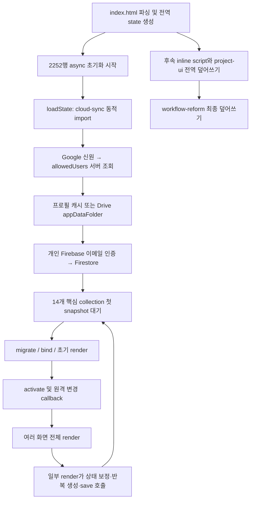
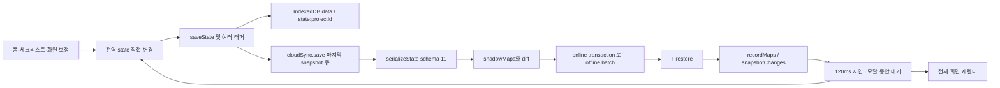

# 전체 시스템 구조 분석보고서

기준 SHA와 검증 범위는 [README](README.md), 위험의 상세 근거는 [기술부채](02-technical-debt.md)에 기록한다.

## 1. 실제 구성과 규모

| 파일 | 행 수 | 책임 및 관찰 |
|---|---:|---|
| `index.html` | 12,231 | HTML, CSS, 업무 모델, 날짜 계산, 전역 상태, 화면, 이벤트, 백업, 인수인계, 여러 세대의 패치 |
| `js/cloud-sync.js` | 1,776 | 인증 화면, 상태 직렬화, 실시간 구독, 충돌 처리, Drive, 휴지통·버전 |
| `js/workspace-profile.js` | 660 | 중앙 Google 신원, 서버 허용목록, 개인 Firebase 접속, Drive appDataFolder 프로필, 토큰 |
| `js/project-model.js` | 224 | UMD 프로젝트 모델; DOM 없이 실행 가능하지만 ID·현재시각·객체 변경을 내부에 포함 |
| `js/project-ui.js` | 1,143 | 프로젝트 CRUD, 단계 UI, 전역 패치, 라이브러리 상세, 별도 반복 엔진, 홈 휴일 |
| `js/workflow-reform-v17.js` | 705 | 진행·완료 화면 통합, 라이브러리 중심 흐름, 구형 자동생성 비활성화, DOM 재수정 |
| `js/google-tasks-sync.js` | 322 | Google Tasks 양방향 동기화; 모델 파일 누락으로 현재 모듈 로딩 실패 |
| `js/firebase-config.js` | 16 | 공개 Firebase 웹앱 설정 및 이전 Drive 마커 |
| `css/project-feature.css`, `css/workflow-reform-v17.css` | 132 / 193 | 프로젝트·통합 업무 UI 보정 |
| `privacy.html`, `manifest.webmanifest`, 아이콘·이미지 | — | 개인정보 안내, 설치 메타데이터, 테마 |

main에는 package manifest, lockfile, 테스트, CI workflow, `firebase.json`, 실제 Firestore rules 파일이 없다. 빌드 없이 루트 정적 파일을 Pages에 배포한다. `sites-prototype/`은 별도 브랜치에만 있다.

`index.html`은 **8,287,061 bytes**다. 정규식으로 추출한 이미지 data URL 문자열이 약 734만 자이고, 같은 문자열의 반복분이 약 272만 자다. 446,267자 WebP가 6회 반복된다(예: 7502, 7580, 7619행). 단순 행 수보다 전송·파싱·캐시 비용이 크다. 이 수치는 문자열 집계이며 네트워크 압축 후 전송량이 아니다.

정적 분석 결과: inline script 42개 + JS 파일 7개, inline style 62개 + CSS 파일 2개. 이름 있는 함수 선언/함수 값 변수 1,039개, 함수 값 대입 614곳(이 중 단순 식별자 대상 238곳), `addEventListener` 133곳, MutationObserver 5곳, 타이머/RAF 호출 113곳이다. DOM `onclick` 대입도 614곳에 포함되므로 전부 monkey patch라고 세면 안 된다. CSS 1개 블록 구문 오류로 나머지 63개 블록만 집계했을 때 규칙 2,094개, `!important` 2,011개다. 동적으로 주입되는 CSS는 이 집계 밖이다.

## 2. index.html 내부 구획

| 범위 | 주요 내용 |
|---|---|
| 1~1673 | 메타, 누적 테마·반응형 CSS, 홈/업무/라이브러리/휴일/설정/이력 화면 |
| 1674~6061 | 초기 앱과 V2~V32 재정의: 저장, CRUD, 반복·연계, 라이브러리, 인증 연결, 검색, 휴지통, 버전, 연간업무 |
| 6063~7488 | 메뉴/화면 설정, 데스크톱 정렬, IME, 과거 보충, rolling, 완료 재개 |
| 7490~8674 | Kitty 테마·중복 이미지, 모바일·표 UX 보정 |
| 8683~9681 | 읽기 전용 인수인계 HTML 생성, 첨부 수집, 자체 ZIP writer |
| 9682~10103 | Shinchan 테마, 모바일 업무 명칭 재수정 |
| 10202~11507 | 홈 위젯 이동/크기/숨김/복원, 설정 화면 재배치 |
| 11540~12150 | 빠른 업무·복제, 용어 보정, Cloud 재연결, 구 Drive 복구 |
| 12152~12230 | 프로젝트 모델/UI 로딩, Google Tasks bridge/module, 첫 단계 일정 패치, workflow-reform 최종 로딩 |

각 script의 정확한 시작·끝은 [script-blocks.csv](evidence/script-blocks.csv)에 있다. 파일을 이 범위 그대로 잘라내면 실행 순서 문제도 그대로 이전된다.

## 3. 실행 순서와 실제 유효 함수

같은 classic script 안의 동일 이름 함수 선언은 실행 전에 마지막 선언이 바인딩된다. 따라서 첫 `renderHome` 정의가 반드시 먼저 쓰이는 것이 아니다. 반면 `const base=renderHome; renderHome=function...`는 그 시점의 함수 참조를 캡처한다. 후속 파일 로딩과 async 인증 완료 시점이 함께 최종 동작을 결정한다.

대표 중첩: `renderHome` 선언 5개 + 대입 15곳, `renderTaskTable` 선언 5개 + 대입 18곳, `renderSettings` 선언 2개 + 대입 21곳. `openTaskForm`도 선언 2개 + 대입 14곳이다. 이 수치는 정적 위치 수이며 모두 동시에 실행된다는 뜻은 아니다.

최종 `workflow-reform-v17.js:36`에서 `ensureAutoSchedulesV5`, `syncTemplateScheduleV5`, `syncTemplateHistoricalLocalV14`, `backfillAllHistoricalLocalV14`, `pruneRollingOverflowLocalV16`을 no-op으로 만든다. 브라우저에서 이 다섯 함수의 최종 본문을 확인했다. 현재 의도는 **라이브러리에 저장만 해서는 생성하지 않고 명시적으로 등록한 업무를 관리**하는 것이다. 그러나 `project-ui.js:733`의 새로운 반복 엔진은 `saveState`와 `renderTaskTable` 래퍼에서 별도로 살아 있다.

## 4. 상태와 데이터 경로

전역 `state`에는 tasks/projects/templates/holidays/categories/owners/settings/selectedCategories/changeLogs가 있다(`index.html:1687`). UI가 객체를 직접 변경한다. 프로젝트 단계와 task에는 날짜·체크리스트·첨부가 중복 보관된다. 담당자·대분류는 주로 이름 문자열을 식별자로 사용한다. 라이브러리 하위 단계는 배열 위치를 이용한 ref(`step|templateId|index`)도 사용해 재정렬에 민감하다.

`saveState`는 로컬 저장과 클라우드 저장을 `Promise.all`로 진행한다. 이것은 둘 사이의 원자성을 보장하지 않는다. 실패 시 UI rollback을 하는 경로와 하지 않는 경로가 섞여 있다. 직렬화마다 전체 상태를 순회하고, diff 결과만 저장한다. **모든 데이터를 매번 Firestore에 쓴다고 단정할 수 없다.**

### Firestore 논리 스키마

| collection | 내용 / 식별 관계 |
|---|---|
| tasks | 업무 본체, checklist/link는 분리; project·repeat·manual flag도 함께 존재 |
| projects | 프로젝트 aggregate, stages 내 체크리스트/첨부 메타 포함 |
| checklistItems | parentType(task/template/linkedRule), parentId, order; task 항목은 id/done/owner/dueDate |
| taskLinks | taskId별 연계 규칙 |
| templates | 라이브러리 본체, 첨부 메타; checklist/linkedSteps/methodBlocks 별도 |
| linkedRules | rootTemplateId + 배열 order 기반 규칙 |
| manualBlocks | template/linkedRule의 텍스트·사진·파일 블록 |
| owners / categories | 이름 기반 ID와 표시 순서·색상 |
| holidays | date, type, reason, source |
| settings | `main`: 앱 설정과 선택 대분류; holidayApiKey는 제외 |
| meta | schema 11, 휴지통/템플릿 버전 보조 문서; 상시 구독은 schema만 |
| generatedKeys | 생성키와 taskId; 삭제한 업무의 잠금도 유지 |
| changeLogs | 최근 300건, 화면 접근 시 지연 구독 |

핵심 collection은 14개다. `subscribeRealtime`는 Promise를 재사용해 bootstrap/activate의 중복 구독을 억제한다. pending writes 무시, 내용 비교, 로그 지연 조회도 이미 구현되어 있다. 개선할 지점은 무조건적 제거가 아니라 전체 상태 재계산, 동일 기능의 중복 save, 충돌 정책, 대규모 collection 초기 읽기다.

## 5. 인증과 첨부

Google 인증은 중앙 Firebase 앱에서 하고, `allowedUsers/{email}`을 서버에서 확인한다. 승인된 사용자만 Drive의 `work-manager-workspace-v1.json`을 읽고, 그 파일의 개인 Firebase 설정·이메일/비밀번호/UID로 별도 Firebase 앱에 연결한다. 프로필 전체가 localStorage에 캐시된다. SDK 공개 설정값 자체는 비밀키가 아니지만 프로필 안의 `workspace.auth.password`는 자격증명이다. 실제 값은 분석하지 않았다.

신규 workspace provision 함수들은 남아 있으나 main에는 setup 페이지가 없고, 프로필이 없으면 안내 후 중단한다. `firestoreRulesForWorkspaceUid`는 규칙 문자열 생성기일 뿐, 운영에 적용된 규칙의 증거가 아니다.

첨부는 Drive 원본 + Firestore 메타데이터 구조다. 50MB 파일 제한, 메타 생성→미디어 업로드→크기 확인, 401 갱신, 일부 네트워크 재시도, 실패 파일 삭제가 있다. 그러나 Drive 업로드 후 Firestore 저장 실패의 보상 작업은 전체 흐름에서 보장되지 않는다. 이미지 object URL은 캐시되며 세션 전체 수명 관리가 불완전하다. 로컬용 IndexedDB files도 존재하지만 OS 폴더 저장소는 아니다.

## 6. UI·성능·무한 대기 판정

- MutationObserver 5곳: 테마 아이콘, 프로젝트 액션/라이브러리 폼, 사이드바 명칭, 테이블 헤더, 완료 단계 폼 잠금. 대부분 동일 값 검사나 pending 플래그가 있어 **현재 무한 루프가 확정된 것은 아니다**.
- 격리 초기 화면에서 1초 idle 동안 observer callback 추가 실행은 0이었다. 인증 후 대규모 데이터·열린 모달·테마 전체 조합까지 검증한 결과는 아니다.
- resize/orientationchange 정적 등록은 각각 12/11곳이다. 레이아웃·명칭·테마 패치가 같은 이벤트에서 중첩 실행된다.
- `scheduleRemoteApply`는 모달이 열린 동안 120ms 재예약한다. `flush`는 25ms 폴링하며 완료 timeout이 없다. 첫 snapshot 대기도 timeout이 없어 네트워크 중간 장애 시 장기 대기할 수 있다.
- `dateAfter`의 영업일 루프는 모든 날짜를 휴일로 판단하면 종료 상한이 없다. 연계 계산의 20회 pass는 무한 반복 방지 장치지만 cycle 오류를 사용자에게 진단하지 않는다.
- 휴일 온라인 조회는 오류/안내 stub이고, 서비스워커 등록은 발견하지 못했다. manifest/PWA 버튼을 완전 오프라인 앱으로 해석하면 안 된다.
