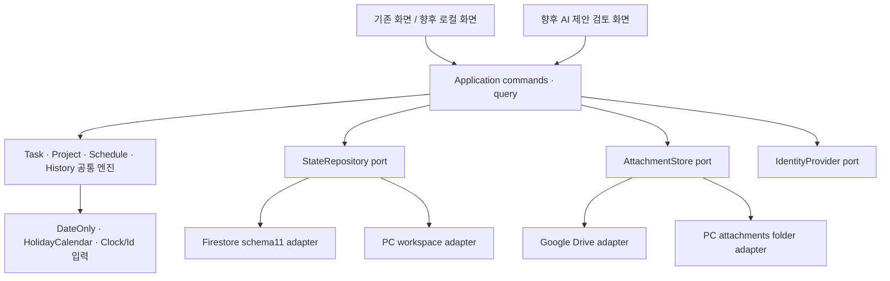

# 공통 업무 엔진 설계서

이 문서는 목표 계약이다. 이번 단계에서 새 모델·데이터 migration을 구현하거나 운영 schema를 변경하지 않는다. 클라우드와 PC 로컬판은 같은 업무 엔진을 호출하고, 저장·파일·인증 adapter만 교체한다.

## 1. 경계와 원칙



엔진은 DOM, window, localStorage, Firebase SDK, fetch, 파일 시스템을 import하지 않는다. `Date.now`, 랜덤 ID, 현재 시간대도 내부에서 직접 읽지 않는다. 모든 입력과 기준일이 같으면 결과가 같아야 한다. UI 상태와 저장 상태를 분리한다. 화면 render/query는 엔진 상태를 변경하지 않는다.

## 2. 공통 모델과 schema11 호환

| 개념 | 공통 책임 | 기존 필드 매핑과 보존 정책 |
|---|---|---|
| Workspace | 저장/권한/시간대 경계 | 개인 Firebase projectId와 actor UID를 구분; 로컬은 새 workspaceId. 사용자 이메일을 ID로 사용하지 않음 |
| Task | 단일 실제 수행 회차 | id/name/category/owner/start/end/deadline/status/actualComplete/notes/relatedDocumentTitle 유지 |
| TaskOrigin | 수동/라이브러리/반복/프로젝트 출처 | templateId/autoSourceTemplateId/dbManualRootTemplateId/dbSourceTemplateId/projectId/seriesId 등을 명시적 tagged union으로 읽되 기존 필드도 호환 출력 |
| ChecklistItem | 항목 ID·문구·담당·기한·완료 | task object[]와 template string[]를 다른 adapter 규칙으로 처리; 배열 index로 task 완료 상태 매칭 금지 |
| LibraryTemplate | 재사용 가능한 규칙·설명·자료 | templates, linkedSteps, methodBlocks, attachments, libraryKindV175 보존. 템플릿 수정과 수행 기록 수정은 다른 command |
| ScheduleRule | 날짜 계산 명세 | basis/startOffset/startMode/limitDays/limitMode/holidayShift/endType/cycle/cycleMonths 등 원뜻을 ruleKind별 보존 |
| TaskSeries / Occurrence | 반복 원본과 발생 회차 | generatedKey/repeatOriginV181/repeatScheduledDateV181/autoRawDate/repeatRawDate/suppressedAutoKeys의 출처를 유지 |
| Project / Stage | 순서·참여자·단계 원본·연결 task | project.id, stage.id, stage.taskId를 고정. stages와 task의 중복값은 adapter가 읽고 충돌을 보고 |
| CompletionRecord | 수행 당시 불변 기록 | 기존 done/actualComplete/체크/일정/자료를 snapshot. 명시적 재개 시 이전 snapshot 보존; 즉시 새 collection migration 금지 |
| AttachmentRef | 제공자 독립 파일 참조 | 기존 driveFileId/localFileId/name/mimeType/size를 읽음. target은 provider/id/name/mediaType/size/hash + source provenance |
| ManualBlock | 설명 텍스트·사진·파일 | type별 union; 실행 HTML을 일반 텍스트 설명으로 취급하지 않음 |
| HolidayCalendar | 주말·공휴일·사용자 휴무 | holidays date/source/type/reason 보존; 달력 version과 정책 분리 |
| Preferences | 표시·검색·테마 등 | 기존 settings에서 화면 설정과 업무 규칙 설정을 논리적으로 분리; key 삭제 없이 adapter round-trip |
| ChangeSet / Archive | 저장할 최소 변경과 이력 | 기존 changeLogs/휴지통/버전과 연결. 전체 state snapshot 대입 대신 entity changes를 점진 도입 |

### 읽기·쓰기 계약

1. `decodeLegacyState(schema11)`는 검증된 normalized view와 경고·미해석 필드를 반환한다. `unknownFields`는 원래 위치와 함께 보존한다. 모든 데이터를 새 구조로 덮어쓰지 않는다.
2. `encodeLegacyChangeSet`는 변경한 필드만 기존 collection 규칙으로 기록한다. 기존 id, generatedKey, Drive ID, linkedRule order 기반 ID를 임의 재발급하지 않는다.
3. 미해석 필드가 있는 객체는 읽기/표시를 허용하되 파괴적 수정을 제한한다. 몰래 drop하지 않는다.
4. 변경하지 않은 fixture는 decode→encode 후 의미상 같아야 한다. 서버 timestamp/revision처럼 SDK가 붙이는 필드는 별도 비교한다.
5. schema11→차기 schema 변경은 별도 지시·migration 계획·backup/rollback 검증 후 진행한다. 엔진 추출 단계에서 데이터 migration을 섞지 않는다.

## 3. 날짜 계산 계약

날짜는 `YYYY-MM-DD`의 **DateOnly**로 저장한다. timestamp는 audit용 UTC ISO로 별도 표현한다. `DateOnly` 계산에 브라우저 timezone 변환을 사용하지 않는다. 업무 기준일은 `Clock.today(workspaceTimezone)`에서 주입하고, 날짜 증감은 순수 달력 연산으로 한다.

| 현재 경로 | 현재 의미 | 전환 계약 |
|---|---|---|
| project stage 상대일정 | 이전 stage의 예정 종료일 + relativeStart/EndDays | start/end offset을 같은 anchor에서 계산; completed anchor 확정 후 계산 |
| DB cascade V152 | 부모 basis에서 시작·기한 모두 계산 | `anchorKind=parent.actualEndOrPlanned`, due는 parent 기준임을 보존 |
| 일반 link | 부모에서 start 계산 후 start에서 due 계산 | `dueAnchor=child.start`인 legacy ruleKind 유지 |
| library→project 초기 생성 | previousEnd→start, start→limitDays | 초기 생성 규칙을 그대로 명시; 편집 규칙으로 전환할 때 effective dates fixture 필요 |
| single-day / duration | same/after/date, 일부 durationDays-1 | inclusive day count와 offset count를 서로 다른 필드로 표현 |
| 휴일 이동 | keep/prev/next, workday/calendar | weekend·custom holiday 포함 기준을 HolidayCalendar로 통일 |

`evaluateScheduleGraph(nodes, calendar, policy)`는 위상 순서로 계산한다. 순환·없는 parent·잘못된 날짜·end<start·최대 탐색 초과를 structured error로 반환한다. 기존 20회 반복 결과를 그대로 정상 일정으로 확정하지 않는다. 각 ruleKind의 golden fixtures가 생기기 전 계산 규칙을 통합하지 않는다.

완료 단계는 계산 전에 확정 입력으로 고정한다. 후속 미완료 단계만 영향 diff에 포함한다. 수동 override와 일정 확정 여부를 명시하고 “모든 단계 재계산”으로 완료 기록을 바꾸지 않는다. 음수 offset, 윤년, 월말, DST, Asia/Seoul과 UTC±시간대를 모두 검사한다.

## 4. 반복업무와 이력

권장 인터페이스(구현 전 계약):

```ts
planOccurrences(series, { from, through, calendar, existing, suppressed }): OccurrencePlan
applyTaskCommand(snapshot, command, { today, now, ids, policy }): CommandResult
reconcileProject(snapshot, draft, { calendar, historyPolicy }): CommandResult
```

`OccurrencePlan`에는 additions/updates/warnings와 각 회차의 안정된 key가 있다. key는 workspace·series 원본 ID·규칙의 회차 식별값·raw scheduled date를 기반으로 한다. 휴일 이동 후 날짜만을 key로 사용하지 않는다. 동일 날짜로 이동한 서로 다른 회차는 구분되어야 한다. 기존 canonical generatedKey는 보존하고 신규 V181 회차는 명시적인 호환 매핑을 만들기 전 재발급하지 않는다.

주기 열거형은 weekly/monthly/quarterly/semiannual/yearly로 정규화하되 `half`를 legacy alias로 읽는다. cycleMonths, weekdays, 분기·반기 편집행(기존 저장은 cycleMonths), until, 기간 길이, 휴일 이동, 1회 override를 별도 정책으로 유지한다. root가 완료되어도 series 규칙의 수명이 종료되지는 않도록 series와 occurrence를 구분한다.

삭제 사유는 `user-suppressed`, `horizon-eviction`, `archive`, `template-deleted`를 구분한다. 사용자 삭제는 재생성 방지 key를 유지한다. 미래 horizon 축소는 사용자 삭제와 다르며 완료·수정된 회차를 제거하지 않는다. 현재 비활성 V16 pruning을 이 설계만으로 다시 켜지 않는다.

동일 planner를 여러 번 호출해도 additions가 더 늘지 않아야 한다. 두 클라이언트의 apply 단계에는 같은 key를 원자적으로 확보하는 저장 계약이 필요하다. 엔진의 메모리 Set만으로 분산 중복을 막았다고 주장하지 않는다.

## 5. 명령·조회·화면 계약

| command | 원자적 도메인 판단 | 발생 가능한 외부 effect |
|---|---|---|
| Create/UpdateTask | 필드 검증, 일정·출처·check ID 보존 | StateRepository.commit |
| Complete/ReopenTask | 체크 완료 조건, 완료 snapshot, 재개 사유 | 상태·이력 commit |
| RegisterLibrary | 일반/프로젝트 변환, 새 instance ID, 선택 규칙 | planned entity changes 저장 |
| UpdateLibrary | 수행중/완료 영향 preview, version snapshot | 명시 선택된 범위에만 commit |
| UpdateProject | 완료 anchor 고정, 단계 추가/이동, 삭제 영향 | project+stage task aggregate commit |
| Archive/Delete | 보호 조건, suppressed key/휴지통 | reference metadata 변경; 파일 삭제는 별도 |
| ImportBackup | schema·참조 검증, 동일 ID 충돌·완료 보호 | 사용자 확인한 ChangeSet만 commit |
| EnsureOccurrences | 기준일·규칙·기존 key로 plan | 별도 application scheduler가 commit |

`CommandResult = {changes, events, warnings, conflicts}`. command는 UI alert/confirm을 직접 호출하지 않는다. application이 preview를 UI에 보여주고, 필요한 선택을 다시 command 입력으로 전달한다. 성공 이벤트 이후 query projection을 갱신한다. 저장 실패 상태를 UI에서 취소할 수 있어야 한다.

검색·달력·간트·연간계획은 같은 normalized read model을 사용한다. query가 `state.settings`를 임시 변경했다 복원하는 현재 패턴을 없애고 filter를 입력으로 받는다. 테마/모바일은 같은 view model을 쓰고 표현만 달라진다.

## 6. 저장 port와 충돌

```ts
interface StateRepository {
  load(scope): Promise<Snapshot>;
  subscribe(scope, onChanges, onError): Disposable;
  commit(changeSet, { expectedRevision, operationId }): Promise<CommitResult>;
  exportSnapshot(scope): Promise<Snapshot>;
  flush({ signal, timeoutMs }): Promise<FlushResult>;
}
```

필드별 base/remote/proposed를 비교한다. 서로 다른 필드 수정은 병합 가능하고 같은 필드의 상반된 수정은 conflict로 반환한다. 완료/재개/삭제는 일반 문자열 덮어쓰기와 다른 정책을 둔다. operationId는 재시도에서도 유지한다.

Firestore adapter는 기존 schema11 collection을 유지한다. 프로젝트+stage tasks+checks의 원자성 범위를 먼저 정한다. Firestore 제한 안에 들어가는 aggregate는 같은 transaction으로 묶고, 초과하는 변경은 작은 사용자 작업으로 제한하거나 별도 staging/operation journal 설계를 검증한 후 도입한다. 320개씩 자른 batch 여러 개를 단일 transaction이라고 설명하지 않는다.

로컬 adapter는 같은 CommitResult를 반환한다. PC 파일 저장 성공과 Firestore 서버 확정은 다른 durability 상태이므로 `localCommitted`, `pendingRemote`, `remoteCommitted`, `conflict`를 UI가 구분한다. 오프라인에서는 재시도 큐를 지속하고 로그인 취소/계정전환 시 다른 workspace에 재전송하지 않는다.

## 7. 단계별 호환 종료 기준

- schema11 fixture의 ID·날짜·완료·첨부 참조 round-trip 손실 0.
- 모든 public engine 함수는 DOM/SDK/IO/암묵적 clock 의존 0.
- 동일 입력 deterministic, 재실행 idempotent, 원본 snapshot mutation 0.
- renderer 호출 전후 업무 상태·저장 호출 수 변화 0.
- 기존 기능 F01~F70의 활성/숨김/비활성 상태가 합의된 범위 그대로 유지.
- 의도적 버그 수정은 “추출”과 분리하여 기존 관찰값·목표값·영향 fixture를 기록.
