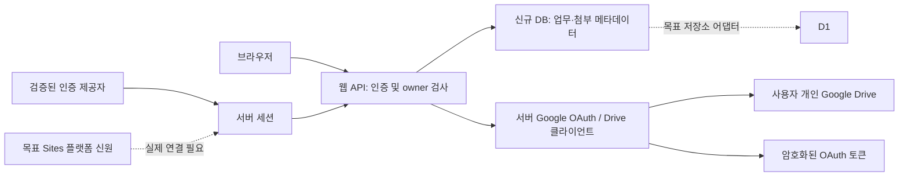

# DB·인증·첨부 설계

## 경계

현 구현은 동일 origin UI/API, FastAPI, 단일 프로세스 SQLite다. 신규 앱은 Firebase/Firestore/CDN 스크립트를 참조하지 않는다. 실제 사용자 인증이 없으면 보호된 기능은 모두 401 또는 설정 미완료 503이다.

## 데이터 모델

| 테이블 | 주요 필드 | 사용자 분리 방식 |
|---|---|---|
| users | UUID id, issuer, subject, display_name | `(issuer, subject)` 유일. 이메일/사용자 ID 입력으로 로그인하지 않음 |
| sessions | SHA-256 token_hash, user_id, csrf, expires_at | 32-byte 무작위 세션, 원문 토큰은 쿠키에만 있음. 8시간 만료 |
| oauth_flows | state_hash, kind, binding_hash, verifier, nonce, expires_at | 10분, 세션/로그인 flow cookie에 결합, 조건부 DELETE RETURNING으로 한 번만 소비 |
| tasks | id, owner_id, title, notes, status, created_at, updated_at | 모든 API query에 owner 조건. `(id, owner_id)` 복합 unique |
| google_connections | owner_id, google_sub, email, token_ciphertext, folder_id | owner 1개당 Google 계정 1개. google_sub도 unique. 토큰은 사용자 UUID를 포함한 암호화 envelope |
| attachments | id, owner_id, task_id, name, mime_type, size, provider, remote_id | `(task_id, owner_id)`가 tasks의 복합 키를 참조. 파일 UUID로 접근해도 owner 검사 |
| demo_connections / demo_blobs | 임시 테스트 파일 fixture | 자동 테스트에서만 주입. 환경변수나 HTTP API로 활성화 불가. 운영에서는 읽기 금지 |

한 DB 안의 논리적 사용자 분리다. 사용자마다 별도 DB 서버를 만들지는 않는다. DB/서버 관리자 또는 Sites 편집자는 저장소에 접근할 수 있으므로 일반 방문자 접근 차단과 관리 권한을 혼동하지 않는다. 데이터베이스 수준 RLS는 현재 사용하지 않으며 애플리케이션 owner 검사와 복합 외래키가 경계를 구성한다.

## 인증

- `app/auth.py`는 인증 공급자와 독립적이다. 검증된 issuer/subject를 받은 뒤 내부 UUID를 연결하고 세션을 발급한다.
- 독립 실행용 일반 OIDC는 authorization code, PKCE S256, state, nonce, RS256 signature, 고정 JWKS URL, issuer/audience/azp/exp/iat 검증을 사용한다. 서버에 여섯 OIDC 설정이 모두 있어야 활성화된다. 이것은 ChatGPT Sites 로그인 구현이 아니다.
- Sites의 실제 신원 수신 계약은 `sites-adapter/identity.mjs`에 분리했다. 현재 API는 oai-authenticated 헤더를 무시한다. 신뢰 가능한 플랫폼 ingress에서만 해당 모듈을 연결해야 한다.
- 운영 쿠키는 `__Host-wm_session`, Secure, HttpOnly, SameSite=Lax, Path=/이며 Domain을 지정하지 않는다. 로컬 개발만 HTTP 쿠키를 허용한다.
- 변경 API는 정확한 Origin과 세션에 묶인 X-CSRF-Token을 요구한다. 다른 사이트 CORS 허용 없음. 로그인/연결 callback은 state 검증을 사용한다.
- 로그아웃 시 DB 세션과 해당 OAuth 흐름을 삭제한다. Sites에 연결할 때는 플랫폼 signout과 애플리케이션 세션 폐기까지 함께 확인해야 한다. 현재 구현만으로 Sites 계정 전환/로그아웃이 연동되지는 않는다.
- 토큰, 키, OAuth callback code가 access log에 남지 않도록 기본 실행은 access log를 끈다. 프록시/호스팅 계층도 query 로그를 마스킹해야 한다.

## Google와 파일

ChatGPT 신원과 Google 신원은 별개다. ChatGPT 계정 A가 로그인한 세션에서만 A의 Google 연결을 만들 수 있다. 반환된 ID token subject로 Google 계정을 식별한다. 두 앱 사용자가 동일 Google 계정을 연결하면 거부한다. 기존 Google 계정을 다른 계정으로 바꾸는 기능은 파일 소유권 정책이 준비될 때까지 제공하지 않는다.

`openid email https://www.googleapis.com/auth/drive.file`을 요청한다. Drive 전체 접근/appDataFolder 권한은 요청하지 않는다. 사용자 전용 폴더에는 서버 생성 UUID를 appProperties로 기록해 재연결 시 찾아 재사용한다. Drive 공유 API를 호출하지 않는다.

토큰은 Fernet(AES 기반 인증 암호화)으로 암호화해 DB에 저장하며 키는 서버 환경에 둔다. access token 만료 60초 전에는 서버에서 refresh한다. 암호화 데이터 내부 owner UUID가 일치하는지도 검사한다. 이메일·폴더/파일 식별자 등 메타데이터는 DB에서 암호화되지 않으므로 DB 자체 접근도 제한한다.

첨부는 최대 10MB. 업로드는 서버로 보내고, 서버가 owner를 확인한 후 Drive로 전달한다. 클라이언트에 Google 토큰이나 remote file ID를 반환하지 않는다. 다운로드 역시 소유권 검사 후 서버가 원본 바이트를 가져온다. 항상 attachment 및 octet-stream 응답을 사용하고 텍스트 조회는 textContent로 렌더링한다. HTML/실행 파일을 같은 origin 문서로 실행하지 않는다. 이미지/PDF 내장 미리보기는 현재 범위 밖이다.

## 운영 한계

- SQLite WAL은 단일 서버 영구 디스크에서 검증했다. Sites D1로 연결 시 DB adapter와 런타임 코드를 이식하고 재검증해야 한다.
- 토큰/폴더 작업의 사용자별 lock은 현재 프로세스 안에서만 유효하다. 여러 replica/worker에서는 D1의 조건부 갱신·작업 lease/중복 방지로 대체해야 한다.
- 첨부 원본과 DB는 분산 트랜잭션이 아니다. 메타데이터 저장 실패 시 Drive 삭제를 시도하지만 실패한 정리 작업의 영구 queue/reconciliation은 미구현이다.
- 프로세스는 정상 JSON 요청 32KB, 첨부 10MB 제한을 둔다. 공개 서비스 전 호스트의 전체 body 제한, rate limit, 사용자 용량 quota, 모니터링을 추가해야 한다.
- SQLite 백업은 `sqlite3.Connection.backup()` 등 일관된 snapshot 방식으로 수행한다. 실행 중 DB 파일만 복사하면 WAL 내용이 빠질 수 있다. 암호화 키는 DB와 분리해 보관/백업한다. 자동 백업·키 rotation·계정 삭제/revoke UI는 후속 작업이다.
- Google Drive 소유자가 Drive UI에서 별도로 공유한 파일은 Google 자체 권한을 따른다. 앱을 통한 타 사용자 접근 차단과 Drive에서 사용자가 만든 공유 링크는 서로 다른 경계다.
