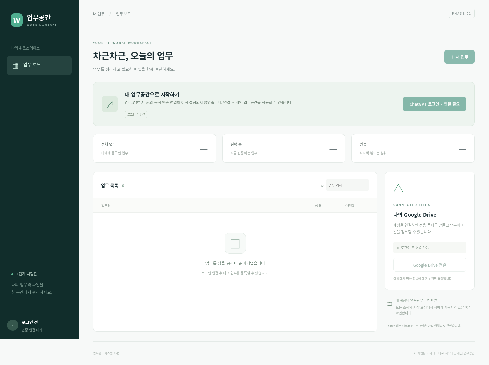

# 1단계 검증 결과

개발 브랜치: `dev/sites-phase1`. 기준 원본: `091dbecd701153e7e1880bd6bb84a277b789c58f`.
검증일: 2026-10-23 (Asia/Seoul). 원본 GitHub Pages 파일을 변경하지 않고 `sites-prototype/`만 추가했다.

## 실행 결과

| 검사 | 결과 | 실제로 확인한 범위 |
|---|---|---|
| 새 Python venv에 requirements 설치 | 성공 | 기존 시스템 패키지에 의존하지 않고 설치. 전체 버전 requirements.lock 저장 |
| `python -m unittest discover -s tests -v` | **29 통과, 0 실패** | API·SQLite·소유권·세션·CSRF·OAuth/Drive 모의 서버·토큰 검증·암호화·재시작 지속성 |
| `node --test tests/sites-identity.test.mjs` | **5 통과, 0 실패, 0 skip** | 확인된 플랫폼 경로/헤더 처리, 기본 불신, 잘못된 신원 거부. 실제 Sites 연결 아님 |
| `python -m tests.browser_smoke` | **7 검증 묶음 통과, 0 실패** | 실제 Chromium의 화면/폼/업무/첨부/다운로드/두 사용자 격리/로그아웃 |
| Node JS syntax / Python compile | 통과 | 신규 앱 소스 문법 |
| `pip check` | 통과 | 가상환경 의존성 충돌 없음 |
| 앱 재시작 및 HTTP | 통과 | `/healthz`, `/`, `/api/config` 200; 미로그인 `/api/tasks` 401; 미설정 `/auth/login` 503 |
| D1 후보 SQL | 로컬 SQLite에서 통과 | 반복 적용 및 예상 테이블 생성 확인. 실제 D1에서는 미실행 |

테스트 runner의 종료 코드를 확인했다. 보호를 위한 401/403/404/409/413 반환은 테스트가 기대한 성공 조건이며, 실제 서비스 오류를 성공으로 숨긴 것이 아니다.

증거: [API 상세 로그](test-evidence/api.txt), [Sites 계약 로그](test-evidence/sites-identity.txt), [브라우저 결과 JSON](test-evidence/browser.json).

브라우저 테스트 첫 실행에서 상태 select의 label 조회가 timeout으로 실패했다. select에 명시적 접근성 label을 추가한 뒤 같은 테스트를 재실행해 통과했다. 최종 코드에서는 실패 0이다. Starlette TestClient의 httpx 관련 deprecation warning이 있으나 테스트 실패는 아니며 향후 라이브러리 갱신 시 전환을 검토한다.

## 목표별 판정

| 사용자 목표 | 구현 상태 | 검증 결과와 미완료 사항 |
|---|---|---|
| ChatGPT Sites 웹사이트 실행 | **미완료** | 독립 FastAPI 서버는 실제 실행. Sites 도구가 없어 생성/버전 저장/배포를 수행하지 않음. 런타임 이식 필요 |
| ChatGPT 계정 로그인 | **미연결** | 공식 경로·헤더 확인 및 경계 모듈 테스트. 실제 플랫폼 인증 미실행. 가짜 로그인 UI/API 없음 |
| 사용자별 업무 저장 | **독립 시험판 검증됨** | 생성·조회·수정·상태 변경·SQLite 영속성·owner 필터. 두 자동 테스트 사용자로 검증. 실제 Sites/D1 검증은 대기 |
| 사용자별 Google 연결 | **구현 / 외부 미검증** | OAuth code+PKCE/state/nonce, 서명·issuer/audience 검증, 사용자별 암호화 토큰. 모의 프로토콜 테스트 통과. 실제 client/동의 없음 |
| Drive 동의·전용 폴더 | **구현 / 외부 미검증** | drive.file 최소 scope, 폴더 생성/재사용/실패 재시도와 동일 Google 계정 중복 연결 거부를 모의 서버로 확인 |
| 첨부 업로드·조회·다운로드 | **독립 시험판 검증됨 / 실제 Drive 대기** | 테스트 저장소에서 실제 브라우저 업로드·조회·다운로드 바이트 일치. Google client의 왕복은 모의 서버로 확인 |
| 타 사용자 데이터·파일 차단 | **자동 테스트 검증됨** | A/B 별도 세션·브라우저, 업무 조회·수정·첨부 업로드 및 파일 metadata/content 차단. 실제 ChatGPT 두 계정 검증은 대기 |

## 실제 검증하지 않은 사항

- ChatGPT Sites 계정 로그인/전환/로그아웃 및 gateway 헤더 위조 방어.
- Sites의 실제 starter 빌드, D1 binding, 영구 데이터, secret 주입, 공개 URL.
- Google OAuth consent 화면, 실제 계정 승인, 실제 Drive 폴더/파일 생성 및 토큰 갱신/철회.
- 실제 계정 A/B의 end-to-end 격리, Google Drive에서 사용자가 직접 공유했을 때의 별도 권한.
- 부하/장시간/다중 replica, 대용량 파일, 자동 백업, 계정 삭제, Google revoke UI.
- 기존 전체 업무 기능(반복/프로젝트/간트/휴일/인수인계/Google Tasks)의 신규 이전.

이 항목들은 성공으로 표시하지 않는다. 필요한 설정 위치와 재검증 방법은 [Sites 안내](02-sites-findings.md), [Google 안내](04-google-oauth.md), [두 계정 테스트](05-two-account-test.md)에 있다.

## 화면 증거

실제 제품 실행은 로그인 미연결 상태다. 자동 테스트 세션을 일반 로그인으로 제공하지 않는다.

[모바일 화면](test-evidence/signed-out-mobile.png)도 390px 너비에서 수평 넘침 없이 확인했다.
